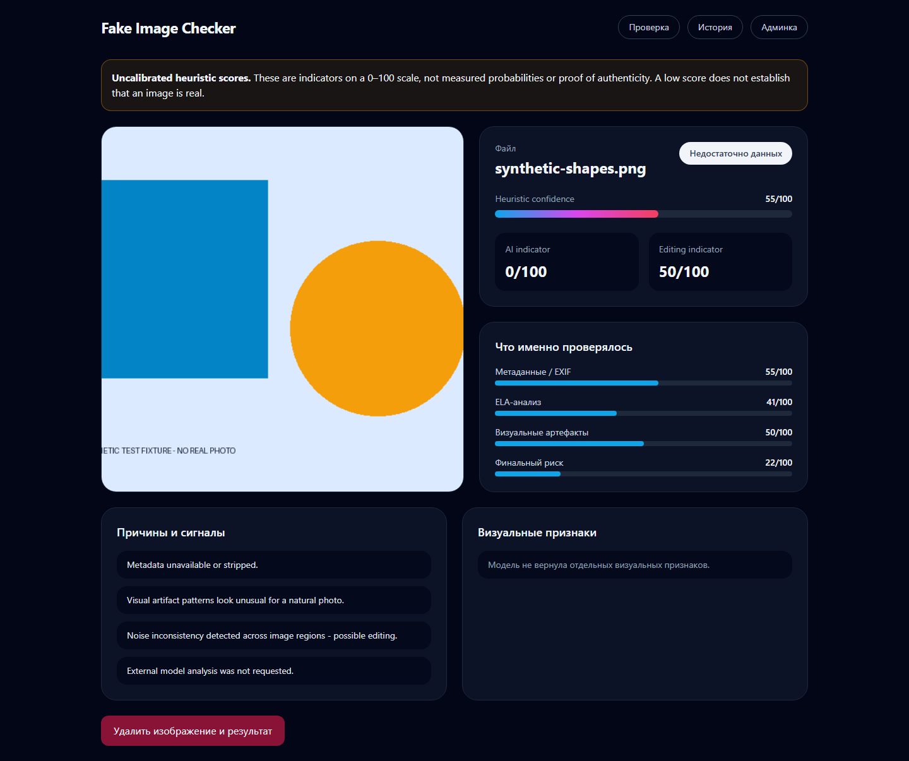
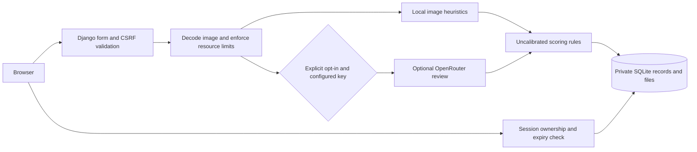

# Fake Image Checker

A Django prototype for exploring image authenticity signals. It combines local checks (metadata, error-level analysis, and visual artifacts) with an optional vision-model review through OpenRouter.

**Important:** The result is a heuristic assessment, not proof that an image is genuine, edited, or AI-generated. Scores should not be used for high-stakes decisions.

## Real interface



[Mobile capture](docs/images/result-390.png) · [Verification and privacy review](docs/VERIFICATION.md) · [Evaluation plan](CALIBRATION.md)

These are actual Chromium captures of this application processing a synthetic geometric image with external analysis disabled. The pictured score is **not** an accuracy measurement. The existing interface is primarily Russian; setup and engineering documentation are in English.

## What it does

- Accepts JPG, PNG, and WEBP uploads.
- Checks file metadata and basic image-level signals.
- Optionally asks a vision model to describe suspicious details.
- Combines the checks into a result with reasons and individual scores.
- Stores previous analyses in SQLite and provides a history page.

## Tech stack

Python, Django 5.2 LTS, SQLite, Pillow, OpenCV, NumPy, and OpenRouter API.

## Run locally

Use Python 3.11 or 3.12 with the pinned dependencies below. Clone the repository, open a terminal in the project folder, and create a virtual environment:

```powershell
py -3.12 -m venv .venv
.\.venv\Scripts\python.exe -m pip install -r requirements.txt
if (-not (Test-Path -LiteralPath .env)) { Copy-Item .env.example .env }
```

Open `.env` and configure `OPENROUTER_API_KEY` if you want the external vision-model step. Without a key, the application reports that the model check is unavailable.

**Configuration safety:** The sample `.env` is for local development only (`DEBUG=True` and a placeholder key). For any non-debug deployment, use `DEBUG=False` and set a unique `DJANGO_SECRET_KEY` of at least 32 characters. The application now refuses to start in non-debug mode with a missing or placeholder secret. Set `OPENROUTER_API_KEY` in the environment or `.env`; the old fallback that read a local `txt` file has been removed. If your setup depended on that file, migrate its value into `.env` and delete the old file. Do not publish either secret.

Set up the database and start Django:

```powershell
.\.venv\Scripts\python.exe manage.py migrate
.\.venv\Scripts\python.exe manage.py runserver
```

Then open `http://127.0.0.1:8000/`.

Uploads are limited to 10 MiB and 20 million pixels by default. Set
`MAX_UPLOAD_SIZE_MB` and `MAX_UPLOAD_PIXELS` in `.env` to adjust these limits.
The form verifies the actual image format and decodes pixels before saving;
damaged images and Pillow decompression-bomb warnings are rejected.

## Checks and tests

```powershell
.\.venv\Scripts\python.exe manage.py check
.\.venv\Scripts\python.exe manage.py test tests --verbosity 2
```

GitHub Actions runs these checks on Python 3.11 and 3.12. Tests cover score
normalization, API-failure scoring fallback, and image upload validation using
generated images. Database/client tests cover session ownership, protected media,
expiry, deletion, CSRF, consent, non-finite scores and malformed upstream replies. They mock OpenRouter and do not
measure detection accuracy. Django creates and destroys an isolated test database.

## Main routes

| Route | Purpose |
| --- | --- |
| `/` | Upload an image |
| `/check/` | Process a submitted image (POST) |
| `/result/<id>/` | Show an analysis result |
| `/history/` | View recent analyses |
| `/image/<id>/` | Read an image owned by the current session |
| `/delete/<id>/` | Delete an owned image and result (POST with CSRF) |
| `/admin/` | Django administration |

## How the analysis works

1. Django validates and saves the uploaded file.
2. Local analysis extracts metadata and calculates image heuristics.
3. Only with explicit per-upload consent and a configured key, the server sends the original image (including metadata) to the OpenRouter model.
4. The scoring module combines the results and stores an explanation in SQLite.

Most of the application logic lives under `detector/services/`; request handling is in `detector/views.py`.

## Privacy and retention

Results, history and image downloads require the uploading browser session.
Clearing cookies or losing the session removes access; this is not an account
system. Server administrators can still access stored data. Responses disable
browser caching. Raw upstream responses are not stored for new analyses.

Access expires after 24 hours (`ANALYSIS_RETENTION_HOURS`). Expiry does not itself
erase data. The operator must schedule cleanup; preview first:

```powershell
.\.venv\Scripts\python.exe manage.py purge_expired_analyses
# Irreversible: deletes expired records and their source files, including legacy records.
.\.venv\Scripts\python.exe manage.py purge_expired_analyses --delete
```

Users can delete their accessible records earlier from the result page. Storage
errors that raise an exception keep the database row for retry. Backups and any copies retained
by an external provider are outside this command's scope.

**Upgrade:** run `manage.py migrate`. Existing records are preserved without an
owner and cannot be accessed through public routes. Do not expose `MEDIA_ROOT`
through Nginx, a CDN, a public bucket or Django static serving: images must pass
through the protected view. Historical shared links and external caches may need
separate operator cleanup. Do not use shared browser sessions for private images.

## Architecture



## Current limitations

- No independently validated accuracy benchmark; displayed 0–100 scores are uncalibrated indicators, not probabilities. See the [evaluation plan](CALIBRATION.md).
- Image-processing techniques such as ELA can be misleading after resizing or recompression.
- Uploaded images and results remain stored locally until deleted. Session access controls do not replace deployment hardening, rate limiting or a scheduled retention job.
- The default Django settings are intended for local development, not production. `check --deploy` reports missing HSTS, HTTPS redirect and secure session/CSRF cookies. The UI loads Tailwind from a third-party CDN; self-host reviewed assets before handling sensitive uploads in a deployed service.
- Tests cover scoring, uploads and privacy; broader external API integration tests and a deployment-ready configuration remain future work.

## Next improvements

- Validate model behavior against an independent labeled image dataset.
- Add deployment-specific rate limits and schedule the retention command.
- Continue hardening deployment-specific settings (HTTPS, cookies, allowed hosts, logging and rate limits).
- Publish sample results using non-sensitive images and document false positives.

This repository is a learning project and a working prototype, not a forensic verification service.
